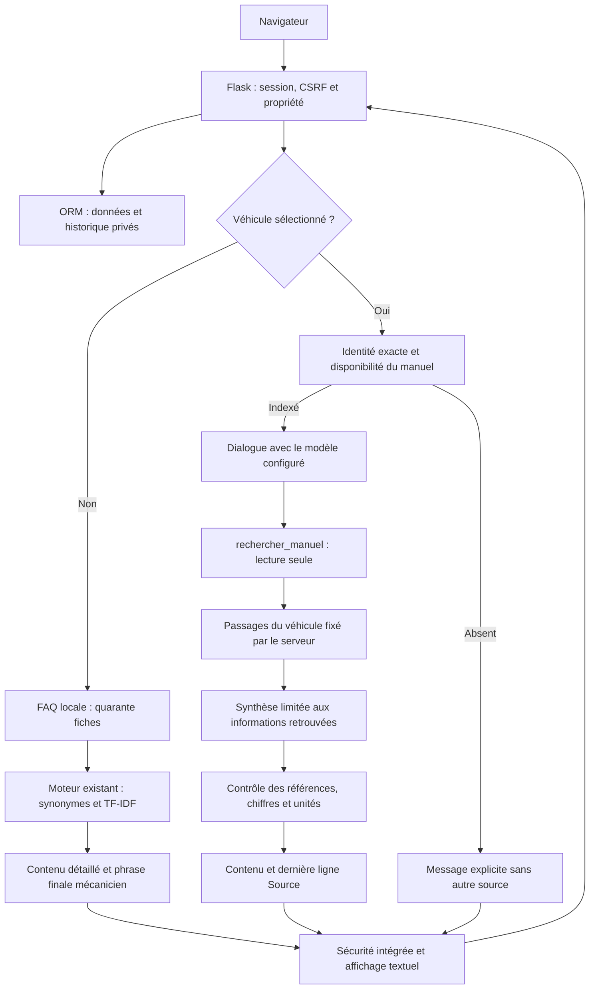

# Complément du 14 novembre 2026 — P0-2 validé

La livraison est désormais reproductible depuis le source : SQLite persistant, port 5000, huit PDF hors image et Git, import lecture seule. L'ancien écart source/livraison est résolu. Le générateur protège les changements locaux et exige une sauvegarde exacte pour adopter une copie personnalisée.

Recette : 326 tests source réussis ; Docker construit et démarré, accueil/health/ready 200, UID non-root, image sans PDF/configuration privée/base. Deux campagnes conteneur : 317 réussis/9 facultatifs ignorés, sans puis avec configuration factice. Bigster complet importé (1721 passages), référence vérifiée et persistance HTTP après recréation. Voir recette.md. La phase de préparation Docker est validée localement, sans revendiquer un déploiement public ni une qualité LLM réelle.

Les sections anciennes PostgreSQL/8000/sans PDF ci-dessous sont historiques. Les commandes actuelles sont dans README.md et README-livraison.md. Prochaine validation : suite PostgreSQL isolée, puis protections contre les abus.

# AutoHELP — Plan d’implémentation et état du projet

**Mise à jour : 14 novembre 2026 — reprise P0-1.** Les résultats d'octobre ci-dessous restent datés ; la nouvelle campagne figure en tête de `recette.md`.

La reprise commence par une sauvegarde intégrale vérifiée puis le versionnement du socle et un audit de l'index Git. Feuille de route : [AMELIORATIONS.md](AMELIORATIONS.md). Le dépôt auparavant sans HEAD reçoit son premier historique ; aucune provenance antérieure n'est inventée. Les fonctionnalités métier restent celles décrites ci-dessous.

**Livraison à préserver :** la copie voisine a évolué indépendamment depuis la recette d'octobre : SQLite, port 5000, import en lecture seule, huit PDF fournis dans `manuels/`. L'équipe confirme le 14 novembre le maintien de ces PDF hors Git et hors image. La description PostgreSQL/8000 et sans PDF des anciennes sections de livraison est historique ; ne pas utiliser l'ancien générateur avant adaptation. P0-2 doit réconcilier le générateur et ces paramètres, puis valider réellement Docker.

Ce document consolide le fonctionnement actuel, les six phases du plan initial et les travaux restant à valider. Il remplace les anciennes descriptions de saisie libre, de relais web et de FAQ désactivée. L’historique reste dans [CHANGEMENTS.md](CHANGEMENTS.md) ; le contrat détaillé des réponses est dans [FORMAT_REPONSES.md](FORMAT_REPONSES.md).

Le projet source est `C:\Users\SafeyeddineK\Desktop\Projet\Projet-GenAIText`. La livraison autonome est générée dans `C:\Users\SafeyeddineK\Desktop\Projet\livraison`. Les changements se font dans le projet source, puis la livraison est reconstruite.

## 1. Règles faisant autorité

Le plan initial `plan_projet_chatbot_automobile.md` et le cahier des charges `CDC_GenAItext.docx` restent les références du socle. Les demandes explicites ultérieures remplacent leurs règles concernées, comme documenté dans CHANGEMENTS.

| Sujet | Fonctionnement actuel |
| --- | --- |
| Nom et langue | AutoHELP, interface et réponses en français |
| Véhicules proposés | Triplets Dacia identifiés dans les PDF locaux, catalogue dynamique |
| Aucun véhicule sélectionné | FAQ générale locale uniquement, sans modèle distant, manuel ou web |
| Véhicule sélectionné | Manuel exact uniquement, puis synthèse des passages par le modèle configuré |
| Absence de manuel ou de passage | Message honnête, sans autre modèle, millésime, FAQ ou web en remplacement |
| Réponse FAQ | Détaillée, sans label ni source affichée, une seule phrase finale vers un mécanicien |
| Réponse documentaire | Contenu fondé sur les passages, dernière ligne Source vérifiée, aucune clôture informative vers un mécanicien |
| Sécurité | Actions dans le contenu, sans bandeau ni avertissement générique répété |
| Protection | Sessions, CSRF, ORM, propriété des ressources, mots de passe hachés et sorties échappées |
| Hors périmètre | Plaque/VIN, entraînement de modèle et notifications email/SMS |

Les anciennes priorités « manuel / Groq / FAQ » et « manuel puis web » ne sont plus actives. Le dataset marocain et l’ancienne FAQ restent conservés comme archives.

## 2. État des six phases

| Phase initiale | État au 25 octobre | Validation ou limite |
| --- | --- | --- |
| 1. Chatbot et connaissances | Implémentée, évolutions intégrées | FAQ détaillée, recherche documentaire et contrôles ; relecture automobile humaine restante |
| 2. Plateforme et données | Implémentée | Comptes, véhicules, entretiens, échéances, administration et isolation testés |
| 3. Intégration et interface | Implémentée | API privée, historique, sélection et formats de réponse vérifiés |
| 4. Tests et recette | Dernière campagne réussie | 311 tests complets, puis 106 contrôles ciblés ; parcours HTTP et évaluation détaillés plus bas |
| 5. Préparation de livraison | Paquet généré et audité | Docker/Compose, migrations et documentation ; démarrage Docker courant non revérifié |
| 6. Déploiement public | À réaliser | Hébergement, domaine, HTTPS et recette de production restants |

Le groupe a demandé Docker prêt à déployer, sans hébergeur pour le moment. Une application locale et un paquet autonome ne prouvent pas l’accessibilité publique ; la phase de déploiement n’est donc pas déclarée terminée.

## 3. Architecture actuelle

| Couche | Réalisation |
| --- | --- |
| Serveur et données | Python, Flask, Flask-SQLAlchemy ; SQLite local et PostgreSQL en production |
| Comptes et formulaires | Flask-Login, Flask-WTF, hachage et CSRF |
| Schéma | Flask-Migrate / Alembic |
| Interface | HTML, Bootstrap local, CSS et JavaScript avec fetch |
| Documents | pdfplumber, pypdf et traitement des polices |
| Recherche | Normalisation, synonymes, mots-clés, TF-IDF et cosinus |
| Modèle | Transport HTTP isolé dans llm_service.py, configuration privée |
| Exploitation | Gunicorn, image Python slim, Compose et volumes persistants |
| Vérification | pytest, modèles factices, PDF fictifs, extrait géométrique et parcours HTTP |

Les versions sont épinglées dans [requirements.txt](../requirements.txt). Le modèle n’a aucun accès direct à l’ORM, à une autre table, au système de fichiers ou à un navigateur.



Aucune branche ne fait appel au web. Le modèle ne choisit ni le véhicule, ni la version, ni la page ou la table à consulter.

## 4. Phase 1 — FAQ, manuels et réponses

### 4.1. FAQ générale sans véhicule

`data/faq_generale.json` contient **40 fiches existantes réécrites**, sans nouvelle entrée lors de la dernière évolution. Champs : `identifiant`, `categorie`, `question`, `reponse`, `mots_cles`, `niveau_risque` ; métadonnées facultatives de recherche : `variantes`, `ancrages`, `exclusions`.

- Réponses stockées de **187 à 209 mots** ; le chargement impose entre 150 et 300 mots et une clôture unique.
- Identifiants uniques, risques faible/moyen/élevé, aucune marque, valeur technique chiffrée ou norme universelle.
- Recherche par le moteur FAQ existant, sans second moteur ; seuil conservé à **0,45**, sans le présenter comme une probabilité.
- Lecture directe du fichier, sans import SQL ni clé API.
- Aucun manuel, historique documentaire ou fournisseur consulté dans ce parcours.

| Catégorie | Fiches |
| --- | ---: |
| Entretien courant | 6 |
| Pneus | 5 |
| Voyants | 4 |
| Batterie | 3 |
| Freins | 3 |
| Sécurité des passagers | 3 |
| Conduite économique | 3 |
| Fuite de liquide | 3 |
| Climatisation | 3 |
| Caractéristiques du modèle | 3 |
| Démarrage difficile | 2 |
| Contrôle technique | 2 |
| **Total** | **40** |

Risque : sept faibles, dix-sept moyens, seize élevés. La réponse explique la notion, les possibilités sans diagnostic, les gestes autorisés, les signes à surveiller et les erreurs à éviter. Elle finit une seule fois par « Pour plus d’informations, consultez un mécanicien. ». Aucun label de mode ni source FAQ n’est affiché.

Les questions précises de pression, huile, capacité, couple ou fusible reçoivent une explication générale sans chiffre inventé. Une sélection du véhicule peut être proposée. Sous le seuil ou pour un sujet non couvert : réponse brève invitant à reformuler ou choisir un véhicule, puis même clôture. Hors sujet : refus poli en une phrase. Une question vague peut recevoir une demande de précision.

L’ancienne base `data/faq.json`, ses **120 entrées**, son import et son administration restent archivés. `flask import-faq` concerne cette archive, pas la nouvelle FAQ générale.

### 4.2. Inventaire dynamique Dacia

`manual_inventory.py` identifie les PDF réellement présents dans `MANUALS_DIR`. Modèle et année doivent être identifiables dans le nom ou la couverture, ou corroborés par une preuve officielle liée à l’empreinte du PDF. Un dossier nommé avec une année ne suffit pas. Les identités inconnues, conflits, doublons et autres marques sont rejetés avec une raison.

Le manifeste relu le 25 octobre comporte **47 entrées, dont huit Dacia actives** avec leurs fichiers locaux présents. Les passages suivants sont ceux du dernier import consigné, sans nouvel import pendant cette mise à jour documentaire :

| Marque | Modèle | Année | Passages du dernier import |
| --- | --- | ---: | ---: |
| Dacia | Bigster | 2026 | 1 721 |
| Dacia | Duster | 2026 | 1 738 |
| Dacia | Jogger | 2026 | 1 643 |
| Dacia | Logan | 2026 | 1 448 |
| Dacia | Sandero | 2021 | 1 292 |
| Dacia | Sandero | 2026 | 1 486 |
| Dacia | Sandero Stepway | 2026 | 1 486 |
| Dacia | Spring | 2026 | 1 078 |
| **Total** | | | **11 892** |

Cette table décrit l’inventaire ; elle ne devient pas une liste codée en dur. Un autre PDF Dacia valide peut compléter le catalogue après identification et import. Les autres marques et les anciens passages restent désactivés ou archivés, sans suppression silencieuse.

La correspondance normalise casse, accents et espaces mais reste exacte sur marque, modèle et année. Sandero 2021, Sandero 2026 et Sandero Stepway 2026 restent distincts. Aucun modèle ou millésime voisin n’est utilisé en remplacement.

### 4.3. Extraction et indexation

- Arborescence recommandée : `data/manuels/<marque>/<modele>/<annee>/manuel.pdf` ; métadonnées dans `index.json` et `sources.csv`.
- Extraction géométrique par colonnes avec pdfplumber, tableaux avec en-têtes, listes et avertissements conservés comme blocs.
- Conservation des pages PDF/imprimée, chapitre, section, versions mécaniques et renvois.
- Détection de pagination dans le pied de page ; l’écart connu du Bigster n’est pas généralisé. Sandero 2021 conserve sa pagination chapitre.page.
- Nettoyage des en-têtes/pieds répétés, numéros isolés et flèches, déhyphénation et normalisation des traits d’union.
- Blocs autour de 700 caractères et chevauchement autour de 80, adaptés aux sections et éléments atomiques.
- Pages quasi vides ignorées ; PDF chiffrés, corrompus ou sans texte signalés sans erreur fatale ni OCR automatique.
- Passages nécessitant un contrôle visuel exclus des réponses jusqu’à levée de réserve.
- Réimport synchronisant le manifeste, les passages actifs et les liaisons, avec archives conservées.

La recette d’import du 24 octobre documente 11 892 passages actifs, dont 671 bloqués et 11 221 utilisables, et 179 851 anciens passages archivés. Ces compteurs de base ne sont pas présentés comme un nouveau comptage aujourd’hui. Détails : [DIAGNOSTIC_ASSISTANT.md](DIAGNOSTIC_ASSISTANT.md) et [ANALYSE_PDF_BIGSTER.md](ANALYSE_PDF_BIGSTER.md).

### 4.4. Dialogue sur un manuel

`answer_service.py` orchestre le parcours ; `llm_service.py` concentre les appels distants. OpenAI est choisi si sa clé est configurée, sinon Groq. Modèles et URL proviennent de l’environnement privé. Sans configuration utilisable ou en erreur distante, message neutre d’indisponibilité ; la FAQ sans véhicule reste accessible.

L’unique outil fourni au modèle est `rechercher_manuel(requete)`, en lecture seule. Aucun identifiant, choix de véhicule, version, page ou table n’est accepté dans ses arguments. Le serveur filtre les résultats sur l’identité exacte, les versions applicables et la qualité documentaire.

La synthèse développe seulement les informations présentes, sans ajouter de mémoire une étape ou une valeur manquante pour allonger le texte. Le serveur rejette les références inconnues, sources non autorisées, valeurs/unités sans support et libellés interdits. Une réponse partielle indique ses limites ; sans information fiable, aucune source n’est inventée.

La réponse commence par le contenu utile et finit par une ligne construite côté serveur :

```text
Source : manuel Dacia Bigster 2026, page imprimée 196, page PDF 198, chapitre La conduite, section …
```

Plusieurs références vérifiées peuvent être réunies sur cette ligne. Une page imprimée inconnue est explicitement non identifiée. La ligne est incluse dans `reply` et conservée dans `source_line` ; le navigateur ne la duplique pas. Aucune clôture informative vers un mécanicien n’est ajoutée. Le contrôle professionnel lié à un danger reste une consigne de sécurité dans le contenu.

### 4.5. Sécurité et archives web

Freins, pneus, direction, airbags, voyants rouges et fuites de carburant conservent les actions adaptées : arrêt, non-reprise, absence de manipulation, assistance et vérification professionnelle. Les consignes restent présentes lors d’une indisponibilité du fournisseur ou d’un manuel absent. Les bandeaux, annonces de mode et avertissements génériques répétés sont retirés.

Le registre `config/sources_fiables.json`, la table `web_passages` et la commande historique `indexer-sources-web` restent **hors du chemin de réponse**. Aucun relais web n’est actif et aucun index web n’est nécessaire à la mise en service actuelle. Le registre n’a pas été élargi.

ManualsLib reste une provenance complémentaire de PDF locaux vérifiés et obtenus avec les droits nécessaires. Ce n’est pas un constructeur officiel ; l’aspiration automatique est désactivée. L’attribution à la page exacte du manuel est conservée. Aucun téléchargement supplémentaire n’est effectué pour cette mise à jour.

## 5. Phase 2 — Comptes, véhicules et entretiens

### Comptes et accueil

Inscription, connexion, déconnexion et suppression confirmée du compte sont implémentées. Les mots de passe sont hachés, les sessions privées et le rôle administrateur inaccessible depuis l’inscription publique. `flask create-admin` crée un administrateur sans identifiants publics prédéfinis.

L’accueil et la navigation vérifient la connexion. Le logo ramène à un accueil proposant le tableau de bord et la déconnexion pour un compte connecté ; connexion et inscription redirigent alors vers le tableau de bord.

### Formulaire et catalogue

Les listes en cascade utilisent Dacia fixe, les modèles issus des PDF identifiés et leurs années disponibles. Le serveur valide le même inventaire et refuse un POST forgé hors catalogue. Motorisation facultative en texte ; kilométrage entier facultatif, non négatif et représentable sur 64 bits.

Un PDF identifié peut rendre un véhicule admissible avant indexation ; les réponses documentaires nécessitent ensuite son import. Les véhicules existants hors inventaire sont conservés et consultables. Le réenregistrement exige une combinaison autorisée ; le chat ne les propose pas et ne leur prête aucun manuel étranger. Commande : `flask lister-vehicules-hors-liste`.

`data/vehicules_maroc.json` reste une archive factuelle sourcée sur cinq marques. Il n’alimente plus les suggestions ou limites du formulaire actuel. Méthode et limites : [catalogue_sources.md](../data/catalogue_sources.md).

### Entretiens et données

Le carnet permet le CRUD des entretiens avec date, compteur, coût en MAD, notes et échéances facultatives. La validation contrôle les champs et la chronologie. Les échéances sont dépassées, atteintes, futures ou absentes selon les données de l’utilisateur ; aucun intervalle constructeur n’est déduit automatiquement.

| Table | Responsabilité |
| --- | --- |
| `users` | Comptes, hachage et rôles |
| `vehicles` | Véhicules privés et référence canonique de manuel |
| `maintenance` | Interventions et échéances saisies |
| `conversations`, `messages` | Historique privé, contexte, textes et références |
| `manuel_passages` | Index documentaire, pages, métadonnées et état actif |
| `faq` | Ancienne FAQ administrable ; la nouvelle FAQ est un JSON |
| `vehicle_catalog` | Archive du catalogue marocain |
| `web_passages` | Ancien index web non utilisé par le chatbot |

Les migrations existantes sont conservées, notamment la référence de manuel et l’archivage des passages. Le dernier format FAQ n’a pas nécessité de migration de base.

## 6. Phase 3 — API, interface et historique

| Route | Fonction |
| --- | --- |
| `POST /api/chat` | JSON : message et identifiants facultatifs de véhicule/conversation |
| `GET /api/conversations` | Conversations du compte |
| `GET /api/conversations/<id>/messages` | Messages d’une conversation du compte |
| `GET /api/vehicle-catalog` | Inventaire Dacia local pour les listes en cascade |
| `GET /vehicles/<id>/manuel?page=…` | Pages indexées du véhicule du compte |
| `GET /health` | État du service et de la base |

Session, CSRF, JSON, taille et propriété sont vérifiés avant la recherche. La réponse expose `reply`, `source`, `source_line`, `references`, `vehicle`, `status`, `conversation_id` et les métadonnées FAQ éventuelles. Les identifiants et scores ne sont pas ajoutés au texte visible. La FAQ n’affiche pas de source ; le manuel finit par la référence vérifiée.

Messages et références sont rendus avec `textContent`, valeurs des templates échappées. `present_stored_reply` adapte la présentation des anciens messages, sans réécriture en base ni création de référence ; leurs consignes sont conservées.

Le sélecteur reste près de la question. Le déplacement précédent répondait à la demande de le proposer à côté de la saisie et est consigné dans CHANGEMENTS. Aucun commentaire supplémentaire ni commit Git n’est disponible (`HEAD` absent, zéro commit lors de la vérification). Proposition : conserver cet emplacement ; aucun retour latéral sans validation du groupe.

### Mémoire et limites

- Historique privé conservé après reconnexion.
- Contexte limité au segment véhicule/motorisation courant ; changement de véhicule : anciens passages écartés.
- Dix messages récents et 5 500 caractères, résumé extractif de 900 caractères sélectionné parmi 80 messages.
- Message utilisateur limité à 1 000 caractères ; contexte sérialisé à 28 000 caractères, sortie modèle à 1 200 jetons et texte de synthèse à 4 000 caractères.
- Quatre tours maximum, budget global de 20 secondes, timeout de 5 secondes et au plus deux tentatives sur certaines erreurs serveur.
- Secrets retirés du contexte et jamais exposés dans les réponses ou journaux.

## 7. Phase 4 — Dernière recette disponible

Les résultats suivants proviennent du **25 octobre 2026** ; ils ne constituent pas une nouvelle exécution pour cette mise à jour documentaire.

| Vérification | Résultat documenté |
| --- | --- |
| Suite pytest complète | **311 réussis en 209,41 s**, aucun échec ou ignoré |
| Gardes après dernier renforcement rouge/huile | **106 réussis en 13,22 s** |
| Nouveaux cas de format | **64 cas**, dont les quarante questions de FAQ |
| Évaluation | **78/78 comportements conformes**, questions inchangées, FAQ réelle et modèle manuel factice |
| Essai réel Bigster | 135 mots, trois références vérifiées, source finale, aucun libellé interdit ni clôture informative vers un mécanicien |
| Parcours HTTP avec véhicule | Inscription, ajout, entretien, discussion, reconnexion et historique, CSRF actif |
| Parcours HTTP FAQ | Détail, clôture unique, refus hors sujet, absence de bandeau et historique après reconnexion |
| Nettoyage | Comptes temporaires supprimés, données préexistantes conservées |
| Application source | Dernier contrôle sur le port 5001 : `/health` HTTP 200 |
| Livraison | Fichiers audités, aucun PDF ou secret, configuration Compose validée |
| Docker courant | Démarrage non revérifié ; les anciennes recettes restent historiques |

Couverture : deux comptes et isolation, CSRF, CRUD, échéances, POST forgés, import, pages imprimées, modèles/années distincts, références inventées, valeurs sans preuve, erreurs distantes et secrets.

Le taux de 78/78 compte aussi les refus et replis conformes. Il ne prouve pas la pertinence de toutes les réponses ou la couverture d’un vrai modèle : le parcours documentaire d’évaluation utilise quatre pages fictives. Les essais réels ne remplacent pas la relecture automobile humaine.

Rapports : [recette.md](recette.md), [FORMAT_REPONSES.md](FORMAT_REPONSES.md), [FAQ_GENERALE.md](FAQ_GENERALE.md) et [questions à poser](../data/questions_a_poser.md).

## 8. Phase 5 — Exploitation et livraison

Docker utilise une image Python slim, Gunicorn, les services `web` et `db`, PostgreSQL et des volumes persistants. Le démarrage applique les migrations et les imports historiques nécessaires. `.env.example` ne contient aucune valeur réelle ; clés, modèles et URL restent privés.

Les PDF sont montés en lecture seule dans web. L’import met à jour le manifeste par un conteneur ponctuel avec montage en écriture. Administration, sauvegarde/restauration et configuration de production sont décrites dans le README.

`python scripts/build_delivery.py` régénère le dossier frère depuis le projet source. Sont livrés : application, migrations, FAQ générale, archives factuelles, tests, documentation et fichiers Docker. Sont exclus : PDF, passages réels en base, index web local, clés, `.env`, bases, Git, environnements virtuels, caches, brouillons et rapports générés. Les métadonnées des manuels sont conservées ; chaque membre fournit ses PDF autorisés et importe son index.

Sans PDF, la FAQ fonctionne. L’ajout d’un véhicule demande un PDF Dacia identifié ; le dialogue sur ce véhicule nécessite son index et un modèle configuré.

## 9. Phase 6 — Travaux restants et critères de fin

| Action restante | Critère de validation |
| --- | --- |
| Relecture des réponses et de la FAQ | Échantillon validé par un professionnel, priorité aux seize fiches à risque élevé |
| Revue des pages/tableaux signalés | Contrôle visuel avant levée de réserve des passages |
| Vérification des éditions/motorisations | Preuves adaptées au document et à l’usage, sans transposition entre véhicules |
| Recette Docker actuelle | Construction depuis livraison, import et `/health`, tests avec/sans fournisseur |
| Installation sur un autre poste | PDF autorisés, inventaire/import contrôlés et configuration privée du membre |
| Hébergement et domaine | Environnement choisi et fourni par le groupe |
| Publication HTTPS | PostgreSQL persistant, secrets, proxy/certificat et recette publique réussie |
| Exploitation | Sauvegarde/restauration et persistance après redémarrage validées sur l’hébergement |

Aucune validation professionnelle globale ni accessibilité publique n’est revendiquée. Le dataset marocain reste archivé avec ses limites ; reconstruire l’ancien index web n’est pas nécessaire au fonctionnement actuel.

## 10. Commandes de reprise

### Livraison Docker

```bat
cd C:\Users\SafeyeddineK\Desktop\Projet\livraison
copy .env.example .env
docker compose up --build
```

Accès prévu : `http://localhost:8000`, sauf changement de PORT. Dans un second terminal :

```bash
docker compose exec web flask create-admin
```

Placer les PDF autorisés suivant [data/manuels/README.md](../data/manuels/README.md), puis importer avec le montage ponctuel en écriture :

```bash
docker compose run --rm --volume ./data/manuels:/app/data/manuels:rw web flask import-manuels
docker compose exec web flask lister-manuels-dacia
docker compose exec web flask evaluer-chatbot
docker compose exec web python -m pytest -q
```

Le compte du conteneur doit pouvoir écrire le manifeste pendant l’import. Renseigner fournisseur, modèle et URL dans le `.env` privé pour le dialogue documentaire ; recréer web après modification de son environnement. Sans clé, FAQ et carnet restent accessibles. `indexer-sources-web` n’est pas une étape de mise en service actuelle.

### Projet source sous Windows

La recette locale utilise Python 3.12 dans `.work/venv`, exclu de Git et de la livraison. L’ancien `.venv` référence un Python supprimé. Sur un autre poste, créer un environnement valide selon le README ou utiliser Docker.

```powershell
cd C:\Users\SafeyeddineK\Desktop\Projet\Projet-GenAIText
.\.work\venv\Scripts\flask.exe --app run db upgrade
.\.work\venv\Scripts\flask.exe --app run lister-manuels-dacia
.\.work\venv\Scripts\flask.exe --app run import-manuels
.\.work\venv\Scripts\flask.exe --app run evaluer-chatbot
.\.work\venv\Scripts\python.exe -m pytest -q
.\.work\venv\Scripts\flask.exe --app run run --host 127.0.0.1 --port 5001
```

Après des changements validés :

```powershell
.\.work\venv\Scripts\python.exe scripts/build_delivery.py
```

Ne pas distribuer les configurations privées ni écraser un `.env` existant sans conserver ses réglages.

## 11. Fichiers pour poursuivre

| Fichier ou répertoire | Responsabilité |
| --- | --- |
| `app/__init__.py`, `app/models.py`, `app/forms.py`, `app/routes/` | Socle, données, validation et droits |
| `app/services/answer_service.py` | Parcours FAQ/manuel, contrôle et sécurité intégrée |
| `app/services/general_faq_service.py` | Validation et recherche de la FAQ générale |
| `app/services/chatbot_service.py` | Moteur partagé et ancien service archivé |
| `app/services/llm_service.py` | Transport, fournisseurs, contrat et limites |
| `app/services/document_tools.py` | Outil manuel et filtrage serveur |
| `app/services/manual_inventory.py`, `manual_policy.py`, `manual_access.py` | Inventaire, identités et accès exact |
| `app/services/manual_import.py`, `manual_extraction.py` | Import et extraction géométrique |
| `app/services/conversation_context.py` | Mémoire bornée et changement de véhicule |
| `app/services/chatbot_evaluation.py`, `tests/` | Évaluation et régressions |
| `app/templates/chat.html`, `app/static/js/chat.js` | Sélection, envoi et affichage textuel |
| `data/faq_generale.json` | Quarante réponses détaillées actives sans véhicule |
| `data/manuels/index.json`, `data/manuels/README.md` | Métadonnées et dépôt des PDF locaux |
| `app/cli.py`, `migrations/`, `docker/` | Commandes, schéma et exploitation |
| `scripts/build_delivery.py` | Génération autonome depuis le projet source |
| `README.md`, `CHANGEMENTS.md`, `FORMAT_REPONSES.md`, `recette.md` | Installation, décisions, formats et validations |

Les anciennes règles et recettes restent dans les journaux dédiés, sans être présentées comme des fonctionnalités courantes dans ce plan.
