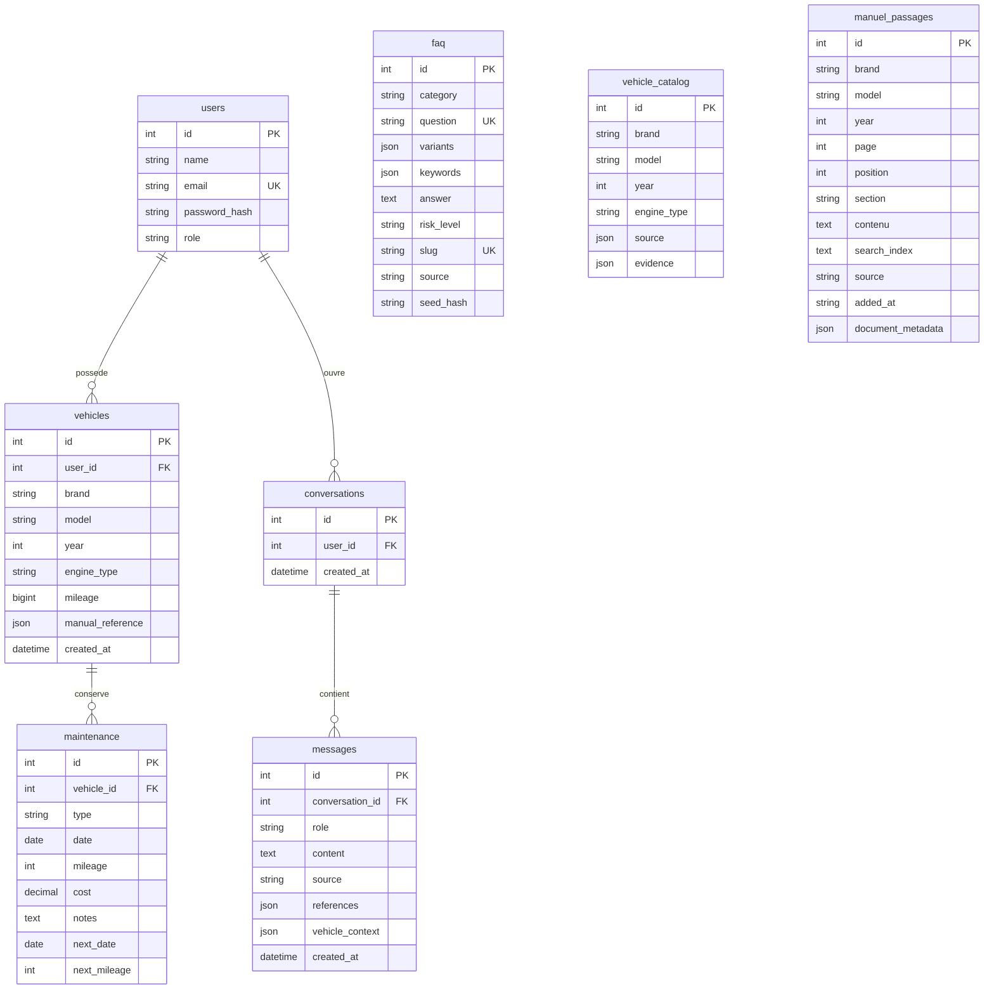

# Conception AutoHELP

## Schéma relationnel



Les suppressions utilisateur/véhicule/conversation propagent la suppression des enfants via les relations ORM. Les dates de message sont créées en UTC. Aucun identifiant automobile sensible n’est stocké. La base ne fournit pas de calcul d’échéance constructeur : les seules échéances sont celles de l’utilisateur.

Les véhicules personnels sont limités aux triplets issus de `manual_inventory.scan_manuals` : uniquement Dacia, modèle confirmé par la couverture et année explicitement identifiable ou corroborée par une période officielle vérifiée et l’empreinte du PDF. La disponibilité provient du dossier configuré, sans constante de modèles ni suggestions marocaines. Le même inventaire sert au formulaire Dacia/modèle/année, à tous les POST serveur et au filtrage du chat. La comparaison est exacte, normalisée par `manual_policy.reference_key`. Une marque étrangère ou une combinaison sans PDF admissible reçoit HTTP 422. Motorisation et compteur restent facultatifs ; la liaison à l’index est recalculée côté serveur. Le formulaire peut enregistrer un PDF identifié encore à indexer, mais le chat ne répond qu’avec des passages actifs exacts.

Les anciens véhicules hors liste sont conservés. Leur consultation et l’ouverture du formulaire ne changent rien ; le réenregistrement exige une combinaison autorisée et un POST invalide ne modifie rien. `flask lister-vehicules-hors-liste` affiche ID, compte et identité sans écriture. Le sélecteur du chat filtre ces véhicules, les signale séparément sans manuel et l’API refuse tout remplacement documentaire. Les contrôles de propriété, CSRF et échappement s’appliquent toujours.

`manuel_passages` est un index partagé. Après contrôle du propriétaire, `manual_access.query_for` cherche seulement la référence canonique correspondant actuellement au véhicule. L’outil filtre encore les résultats sur ce triplet. Le modèle ne reçoit aucun identifiant de compte/véhicule ni accès ORM ; son unique argument est `requete`. Tous les autres outils ou paramètres sont refusés. Les textes et pages du lecteur sont échappés.

Sans véhicule, `answer_service.answer_general` lit `data/faq_generale.json` via `general_faq_service`, réutilise le moteur TF-IDF/synonymes FAQ existant et répond localement, sans manuel ni fournisseur. Le seuil est 0,45 et une réponse détaillée se termine par la phrase mécanicien, sans libellé de mode ni source affichée, avec identifiant de fiche en métadonnées et aucune référence de véhicule/page. L’ancienne table FAQ reste archivée. Avec véhicule, `answer_service` orchestre exclusivement le dialogue documentaire. Le modèle effectue un appel natif borné, manuel uniquement, sans relais web ni FAQ ; `document_tools` exécute la recherche en lecture seule. TF-IDF/cosinus, normalisation et synonymes utilisent le seuil conservateur 0,45 hérité de la calibration, sans interpréter le score comme une probabilité. Les termes du véhicule sont retirés de la requête documentaire pour éviter de diluer sa pertinence ; un filtre d’organe empêche notamment de répondre au niveau d’huile avec un passage sur un autre liquide. Le client isole les phases d’appel natif et de synthèse JSON ; la synthèse reçoit les résultats des outils en données, sans nouveaux accès à la base.

`rechercher_web` est refusé et n’est pas fourni au modèle. Le registre des sources autorisées reste conservé sans élargissement, hors du chemin de réponse. Avec véhicule, sans source suffisante : indication honnête sur l’information manquante, sans formule finale vers un mécanicien ; sans fournisseur : indisponibilité neutre. Sans véhicule, la FAQ fonctionne sans clé ; sans fiche pertinente, proposition de reformuler ou sélectionner un véhicule. Le serveur construit les lignes de source et rejette références, chiffres et unités sans support. Une correspondance numérique ne prouve pas toute la fidélité sémantique : relecture humaine nécessaire.

`conversation_context` ne transmet que le segment du véhicule courant : dix messages/5 500 caractères, résumé extractif ancien de 900 caractères, sélectionnés parmi 80 messages. Un changement de véhicule ou motorisation coupe le segment. Les anciens messages FAQ ne sont pas réinjectés. Les messages, sources et références sont enregistrés atomiquement et restent privés. Limites réseau et contexte : voir README.

## Architecture et maquettes

```text
Navigateur HTML / Bootstrap / fetch
           │ session + CSRF
           ▼
Flask : routes → contrôles de propriétaire → ORM → PostgreSQL/SQLite
           │
           ├─ aucun véhicule → FAQ générale locale → moteur FAQ existant → réponse détaillée + phrase finale
           └─ véhicule choisi → dialogue LLM → manuel exact en lecture seule → synthèse et références
```

Maquettes réalisées dans les templates :

```text
Accueil              Tableau de bord          Chat
┌ marque / accès ┐   ┌ navigation privée ┐    ┌ navigation privée ┐
│ titre / dessin │   │ compte / ajout    │    │ titre / avertis.  │
│ inscription    │   │ 3 compteurs       │    │ historique│échanges│
│ 3 fonctionnalités│ │ cartes véhicules │    │ véhicule  │saisie  │
│ confidentialité│   │ échéances         │    │ nouvelle  │envoi   │
└ pied de page ──┘   └ accès assistant ──┘    └ conseils généraux ┘
```

Sur téléphone, les colonnes deviennent une pile ; les tableaux restent dans une zone défilante propre. Contraste sombre sur fond clair, liens soulignés/focus visibles, labels associés, lien d’évitement, statut et journal du chat accessibles au clavier. Aucune image externe ; illustration décorative en CSS masquée aux lecteurs d’écran.

## Trace des exigences

| Exigences | Réalisation / preuve |
| --- | --- |
| EF-01, 07–10, 16, 20 | Pages publiques/privées, formulaires et CRUD ; tests plateforme et parcours |
| EF-02–06 | Service autonome, seuil, avertissements, historique ; tests chatbot/API |
| EF-11–13 | `due_status`, formulaires, cohérence ; cas d’échéance et validation |
| EF-14 (facultative) | Sélecteur avec propriété contrôlée ; aucune personnalisation mécanique inventée |
| EF-15 | Ancien CRUD FAQ archivé ; nouvelle FAQ générale locale seulement sans véhicule |
| EF-17–19 | Contrôles par compte, API JSON, fetch textuel/verrou/délai ; tests isolation/CSRF |
| EF-21 | Health, volumes, migrations, recette redémarrage et restauration |
| CA-01 | Pages fonctionnelles localement ; HTTPS public reporté faute d’hébergeur, conformément au choix utilisateur |
| CA-02–07, 09, 11–13, 16 | Tests automatisés et jeu enrichi de 78 questions, rapport de scores et 20 questions de démonstration |
| CA-08, 14 | Recette navigateur et responsive ; parcours Docker complémentaire |
| CA-10 | Code, README, conception, FAQ, migrations, tests et livraison autonome |
| CA-15 | Recette Docker persistance et sauvegarde/restauration séparée |

## Support de démonstration

1. Besoin : centraliser le carnet et rendre l’information courante accessible.
2. Solution : garage personnel, historique et échéances saisies, assistant LLM documenté, coût dépendant du fournisseur.
3. Architecture : Flask, ORM, PostgreSQL, service indépendant et interface fetch.
4. Démonstration : inscription → véhicule → entretien → question → reconnexion.
5. Qualité : score du chatbot, droits entre comptes, validation et sécurité.
6. Exploitation : Docker, volumes, migrations, administrateur privé et restauration.
7. Limites : pas de diagnostic ; couverture documentaire partielle, édition et motorisation à vérifier ; publication HTTPS à effectuer sur l’hébergement choisi.

## Migrations et exploitation

`web_passages` conserve URL exacte, nom du site, titre, date, position, contenu, région et type. `messages.source_line` conserve les sources affichées. La migration `e41ac907d256` ajoute le triplet de manuel, le compteur facultatif BigInteger et la motorisation texte facultative, avec reprise des correspondances sur les données existantes. Les versions précédentes restent dans la chaîne de migration. Aucun PDF, passage réel ou index web ne doit être distribué ; ils sont importés sur chaque instance. Les dépendances restent inchangées, le transport HTTP utilise la bibliothèque standard.


## Format courant du 25 octobre 2026

`data/faq_generale.json` utilise désormais le champ `reponse`, validé entre 150 et 300 mots. `answer_general` garde la recherche locale, sans modèle ni historique documentaire, et n’ajoute plus de label ni source FAQ visible. La clôture informative est unique. Avec véhicule, `_finalize` conserve les contrôles de références, sources et valeurs avant de construire la dernière ligne `Source`. La réponse contient directement cette ligne ; le client l’affiche comme texte et évite les doublons.

Les actions de sécurité sont intégrées dans les phrases, avec contrôle avant reprise lorsque le risque l’exige ; aucun bandeau. Les cas sans preuve ne produisent pas de source inventée. `present_stored_reply` adapte uniquement la présentation d’anciens messages, sans écriture en base. Le sélecteur reste dans le même bloc de contrôles. Rapport et limites : [FORMAT_REPONSES.md](FORMAT_REPONSES.md).
